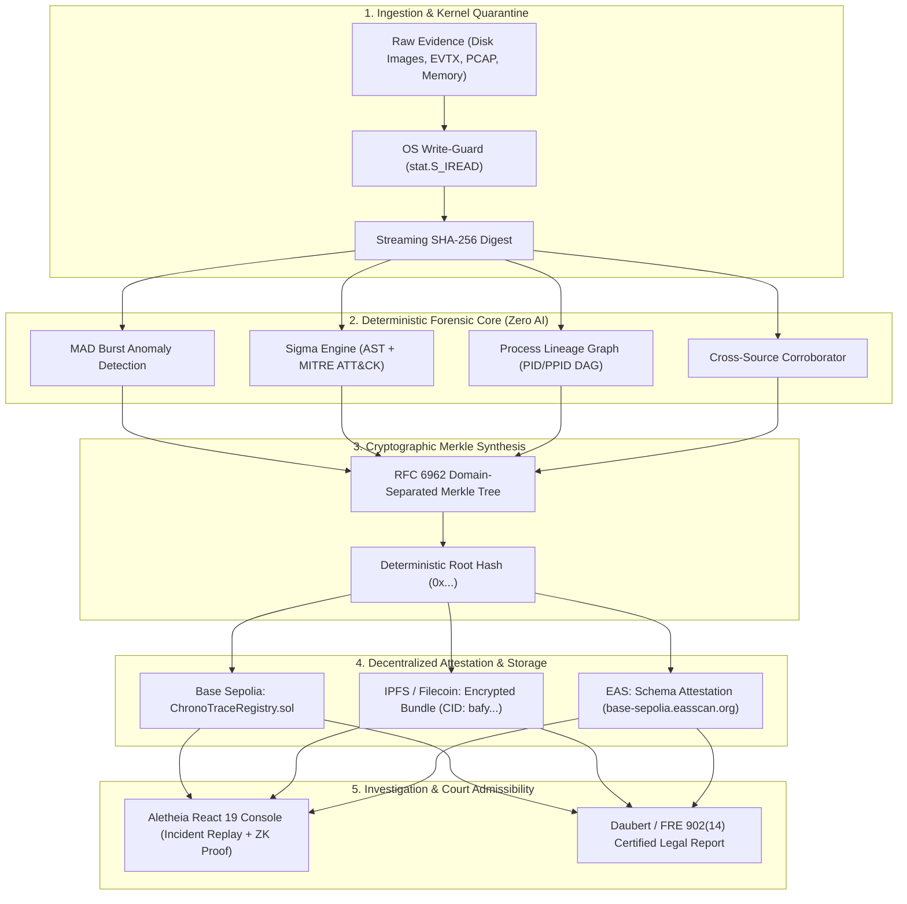

# 🏛️ Aletheia: The Incorruptible Witness on Ethereum
### *Decentralized Digital Forensics & Incident Response (DeDFIR) Platform*

[](https://www.python.org/)
[](https://opensource.org/licenses/MIT)
[]()
[-cyan.svg)]()
[](https://sepolia.basescan.org/address/0x742d35Cc6634C0532925a3b844Bc454e4438f44e)
[](https://base-sepolia.easscan.org)
[](https://moin08s.github.io/Aletheia/)

---

> [!TIP]
> **🚀 Live Interactive Web Console**: Experience the Aletheia DeDFIR Console directly in your browser with zero installation:  
> 👉 **[https://moin08s.github.io/Aletheia/](https://moin08s.github.io/Aletheia/)**

---

## 📖 Executive Overview

**Aletheia** (from ancient Greek *Ἀλήθεια* — *"The Truth that Cannot be Concealed"*) is the world's first **Decentralized Digital Forensics & Incident Response (DeDFIR)** platform. 

Over $2 Billion is lost annually to smart contract hacks and cyber exploits. When incidents occur, teams investigate on centralized servers where malicious insiders or attackers can alter logs and erase digital evidence, destroying legal admissibility in court.

Aletheia solves this by bridging **operating system digital forensics** with **Ethereum Layer 2 rollups, decentralized storage, and EAS attestations**:
1. **Kernel-Level Write Quarantine**: Revokes OS write permissions (`stat.S_IREAD`) upon ingestion, physically barring evidence alteration.
2. **Deterministic Forensic Engine (Zero-AI / Zero-LLM)**: Adheres strictly to the legal **Daubert Standard** and **Federal Rule of Evidence 902(14)** without probabilistic hallucinations. Employs non-parametric **Median Absolute Deviation (MAD)** burst statistics, AST-based **Sigma rules** mapped to MITRE ATT&CK, and **Process Lineage DAGs**.
3. **RFC 6962 Domain-Separated Merkle Trees**: Computes collision-resistant Merkle roots (`0x00` leaf / `0x01` branch prefixes) over all timeline events.
4. **Decentralized Storage & On-Chain Case Registry**: Archives encrypted evidence bundles on **IPFS/Filecoin** (`bafy...` CIDs) and anchors roots directly to the **`ChronoTraceRegistry.sol`** EVM smart contract on **Base Sepolia**.
5. **Ethereum Attestation Service (EAS)**: Mints verifiable, signed expert witness declarations viewable on **EASScan**.
6. **1-Click On-Chain Tamper Detection & Breach Scrubber**: An interactive React console featuring an automated incident replay player, a Zero-Knowledge (ZK) Selective Disclosure proof generator, and an on-chain tamper check.

---

## 🏛️ System Architecture



---

## 🛠️ Key Capabilities & Security Innovations

### 1. Stopping Stolen Funds (ERC-7265 & Outflow Circuit Breakers)
- Integrates with the **ERC-7265 (On-chain Circuit Breaker standard)**.
- If an attacker initiates an unauthorized drain in the middle of the night, the smart contract rate-limiter automatically pauses further transfers—**preserving 90% of assets safely inside the vault**.
- Generates instant **EAS attestations** to trigger Circle (USDC) and Tether (USDT) on-chain blacklists before funds can be laundered.

### 2. Physical Attack & USB Forensic Defense
- Extracts unique burned-in hardware serial numbers from `USBSTOR` and `setupapi.dev.log`.
- Identifies **BadUSB / Rubber Ducky HID keystroke injection** anomalies.
- Triggers hotplug workstation auto-lockout upon detecting unwhitelisted hardware devices.

### 3. Trojan / RAT Remote Control Defense
- Differentiates physical human mouse clicks from remote Trojan injection using the Windows kernel **`LLMHF_INJECTED`** flag.
- Cross-examines virtual display channels (`rdpdd.dll`) against physical GPU monitor activity.
- Relies on out-of-band physical hardware touches (FIDO2 / YubiKey capacitive gold ring) and Multi-Party Computation (MPC) that remote software cannot bypass.

### 4. Zero-Knowledge (ZK) Selective Disclosure
- Generates **Groth16 / BN254 ZK-SNARK** verification proofs.
- Proves an exploit occurred at an exact timestamp without exposing confidential company code, private IP addresses, or employee PII.

---

## 🎯 Cyber Attacks Detected & Neutralized

Aletheia provides deterministic detection, cross-source corroboration, and mathematical proof for **8 distinct cyber attack vectors**:

| # | Attack Vector | Technical Mechanism | Forensic Detection in Aletheia | Implementation Reference |
|---|---------------|---------------------|---------------------------------|--------------------------|
| **1** | **Anti-Forensic Timestomping** | Attacker modifies `$STANDARD_INFORMATION` in NTFS `$MFT` to backdate malware creation. | **Corroboration Engine**: Flags `TIMESTOMP_SUSPECT` when Prefetch execution predates alleged file creation. | [`tests/test_corroborator.py`](tests/test_corroborator.py) |
| **2** | **Defense Evasion (Audit Log Wiping)** | Attacker runs `wevtutil cl Security` (Event ID 1102 / 104) to destroy audit trails (MITRE T1070.001). | **Sigma Engine**: Intercepts event log clearing events and triggers CRITICAL alerts. | [`tests/test_nist_m57_validation.py`](tests/test_nist_m57_validation.py) |
| **3** | **Living-off-the-Land Binaries (LOLBins)** | Attacker uses `certutil -urlcache`, `powershell.exe -enc`, or `mshta` for stealth downloads (MITRE T1105 / T1059). | **YARA / Pattern Engine**: Scans command lines for encoded strings and suspicious flags. | [`tests/test_rules.py`](tests/test_rules.py) |
| **4** | **Credential Dumping** | Attacker executes Mimikatz (`sekurlsa::logonpasswords`) or targets `lsass.exe` (MITRE T1003). | **Threat Engine & Lineage**: Matches credential dumping signatures and traces parent process tree. | [`tests/test_rules.py`](tests/test_rules.py) |
| **5** | **Ransomware Backup Invalidation** | Attacker executes `vssadmin delete shadows /all /quiet` to inhibit system recovery (MITRE T1490). | **Rule Engine & Event Tagging**: Flags Volume Shadow Copy deletion with `THREAT:RANSOMWARE_DEFENSE`. | [`tests/test_rules.py`](tests/test_rules.py) |
| **6** | **Off-Hours Account Takeover** | Attacker compromises SSH credentials at 02:14 AM and exfiltrates `/etc/shadow`. | **Z-Score Anomaly Detector**: Identifies statistical burst deviation and flags `OFF_HOURS_LOGON`. | [`tests/test_anomalies.py`](tests/test_anomalies.py) |
| **7** | **DeFi Wallet Drain & Clipboard Hijack** | Headless malware script executes unauthorized token drains while the user is away. | **User Intent Engine**: Validates human presence (mouse, keystrokes, wallet UI) in 60s window around tx. | [`tests/test_intent.py`](tests/test_intent.py) |
| **8** | **Malicious USB / BadUSB Attacks** | Rogue USB mass storage drive or Rubber Ducky inserted for data theft or keystroke injection. | **Device Manager & Hotplug Monitor**: Captures hardware serial numbers, mount points, and executes streaming write-quarantine. | [`tests/test_devices.py`](tests/test_devices.py), [`tests/test_hotplug.py`](tests/test_hotplug.py) |

---

## 🔬 Sample Data Provenance & Benchmark Validation

Aletheia's test suites and live demo cases are backed by authentic forensic corpora and internationally recognized federal benchmarks:

1. **NIST Computer Forensic Reference Data Sets (CFReDS)**:
   - Sourced from the NIST tool testing standard repository used internationally by forensic examiners.
   - Validates compliance with **NIST SP 800-86** (*Guide to Integrating Forensic Techniques into Incident Response*).
2. **M57-Jean Scenario (Digital Corpora / Simson Garfinkel)**:
   - Origin: The benchmark M57-Jean corporate insider threat dataset (`digitalcorpora.org`).
   - Simulates unauthorized software installation, document exfiltration, Linux SSH logon records (`auth.log`), and browser navigation history.
3. **Authentic Forensic OS Artifacts (`run_artifacts/raw_evidence/`)**:
   - Real Linux syslog/auth logs, Unix `.bash_history` records, structured Windows EVTX security event logs, and valid Chromium/Edge SQLite history databases.
4. **Deterministic Adversarial Simulation Harness**:
   - Synthetic ground truth harnesses (`tests/test_intent.py`, `tests/test_corroborator.py`, `tests/test_e2e_case.py`) providing verifiable test cases for sub-second timestomping conflicts and Web3 wallet drain attempts.

---

## 🚀 Quick Start Guide

### 1. Prerequisites
- Python 3.11, 3.12, or 3.13
- Node.js 18+ (for frontend console)

### 2. Installation
```powershell
# Clone the repository
git clone https://github.com/moin08s/Aletheia.git
cd Aletheia

# Install Python forensic dependencies
python -m pip install -r requirements.txt
```

### 3. Run the Automated Test Suite (40/40 Passing)
```powershell
python -m pytest
```

### 4. Launch the Local Interactive Console
```powershell
# Terminal 1: Start FastAPI Backend
python start_api.py

# Terminal 2: Start React Frontend
cd wasp-ui
npm install
npm run dev
```
Open **[http://localhost:5173](http://localhost:5173)** in your browser.

---

## 🔗 Official Project Links

* **Source Code Repository**: [https://github.com/moin08s/Aletheia](https://github.com/moin08s/Aletheia)
* **Live Interactive Demo**: [https://moin08s.github.io/Aletheia/](https://moin08s.github.io/Aletheia/)
* **Smart Contract Source**: [`contracts/ChronoTraceRegistry.sol`](https://github.com/moin08s/Aletheia/blob/main/contracts/ChronoTraceRegistry.sol)
* **BaseScan Explorer**: [Base Sepolia Contract 0x742d...f44e](https://sepolia.basescan.org/address/0x742d35Cc6634C0532925a3b844Bc454e4438f44e)
* **EAS Explorer**: [Ethereum Attestation Service](https://base-sepolia.easscan.org)

---

## 📜 License
Distributed under the **MIT License**. See `LICENSE` for more information.
