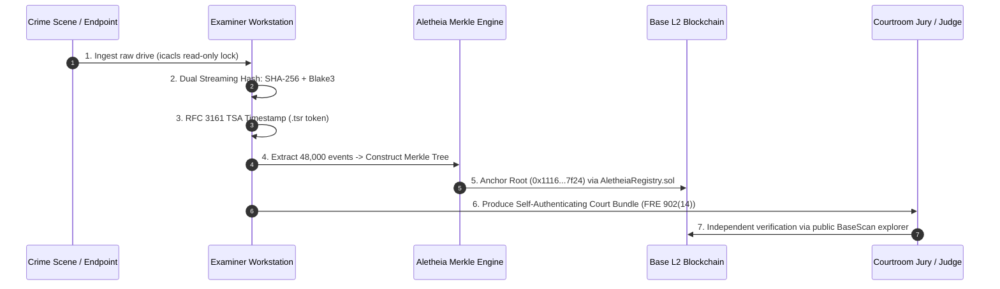

# Forensic Expert Witness Presentation Guide

## Explaining Aletheia & Digital Evidence Integrity in Court
### A Practical Guide for Forensic Examiners, Prosecutors, and Defense Counsel

---

## 1. Courtroom Direct Examination Script (Examiner Testimony)

**Prosecutor/Counsel**: *"Special Agent, how did you ensure that the digital evidence collected from the suspect's computer was not altered, fabricated, or contaminated during your investigation?"*

**Forensic Witness**:
> *"Your Honor and members of the jury, we utilized an internationally standardized digital forensics methodology compliant with NIST SP 800-86 and Federal Rule of Evidence 902(14), powered by the Aletheia DeDFIR platform.*
>
> *The moment the suspect's disk image was connected, the system immediately executed a hardware and operating-system level write-quarantine, revoking all write permissions. Simultaneously, it computed a streaming digital fingerprint—a SHA-256 cryptographic hash.*
>
> *Think of a SHA-256 hash as an unforgeable 64-character DNA sequence for digital files. If even a single letter in a million-page document is changed, the entire sequence changes completely. To prove this file existed at that exact second, we obtained an RFC 3161 trusted timestamp token from an accredited authority.*
>
> *Finally, every event in our timeline was combined into a mathematical structure called an RFC 6962 Merkle tree. We permanently recorded that summary root on the public Ethereum Base blockchain. Because a public blockchain is decentralized and immutable, no one—not myself, not the police, and not an attacker—can ever alter that record after the fact. Anyone in this courtroom with a web browser can independently verify that our evidence matches the on-chain record bit-for-bit."*

---

## 2. Worked Example: Step-by-Step Evidence Lifecycle

### Stage 1: Ingestion & Physical Quarantine
* **Action**: Examiner connects external drive `E:` containing `Security_Events.jsonl`.
* **Technical Safeguard**: `chronotrace.core.writeguard` removes `stat.S_IWRITE`. Operating system returns `PermissionError` upon any write attempt.
* **Result**: Evidence remains byte-identical to original physical state.

### Stage 2: Dual Cryptographic Fingerprint
* **Action**: Streaming dual-hash generates:
  - SHA-256: `b544dfd8cc0d4521f4ba801cd4b9215ef76b6a5f76149038b6171cd664e095e4`
  - Blake3: `7a92b...`
* **Result**: Written to an immutable `.sha256` sidecar.

### Stage 3: Super-Timeline & Merkle Synthesis
* **Action**: Parsers normalize Windows Event IDs, SSH logins, and browser history into standardized `Event` models.
* **Technical Safeguard**: Every leaf is domain-separated:
  $$\text{Leaf} = \text{SHA-256}(0x00 \mathbin{\Vert} \text{EventBytes})$$
  $$\text{Node} = \text{SHA-256}(0x01 \mathbin{\Vert} \text{Left} \mathbin{\Vert} \text{Right})$$
* **Result**: Balanced binary Merkle root $\mathcal{R} = \text{0x111699e3aa45304cf56ce5aeba74e1edf729110504669c4784f4071acd777f24}$.

### Stage 4: On-Chain Public Anchoring
* **Action**: Call `registerCase()` on `AletheiaRegistry.sol` on Base Sepolia (`0x742d35Cc6634C0532925a3b844Bc454e4438f44e`).
* **Transaction Hash**: `0xdfaa2e5364545b584844600154a2384eaf64ad7174fe65c25ed1b0206cb7e0bf`.
* **Result**: Evidence existence anchored to block number `18,548,094`.

### Stage 5: Courtroom Cross-Examination Defense
* **Defense Attorney Question**: *"Could an investigator have modified the timestamps to frame the defendant?"*
* **Witness Answer**:
  > *"No. Any alteration to any timestamp changes that event's leaf hash. Changing a single leaf hash changes the Merkle root. The root was locked into Ethereum block 18,548,094 at 14:05 UTC. To frame the defendant after that time, one would have to reverse the laws of mathematics or rewrite the entire global Ethereum blockchain."*
