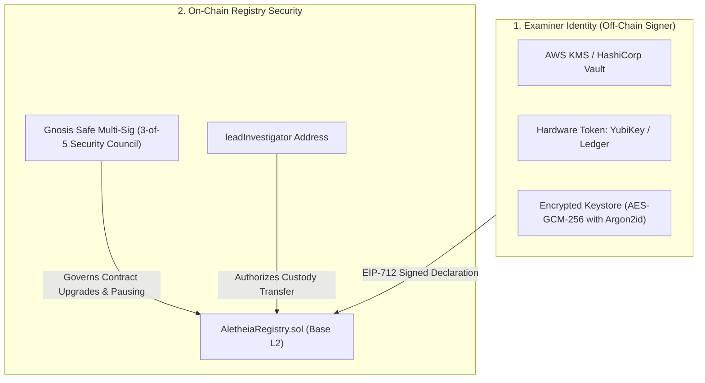

# Aletheia Key Management & Custody Architecture

## 1. Overview & Trust Anchor Disclosure

> [!IMPORTANT]
> **Single Point of Trust Disclosure**:
> In digital forensics, any cryptographic attestation is only as reliable as the private key that signs it. Whoever holds the signing key has the authority to anchor cases to the on-chain registry (`AletheiaRegistry.sol`).
> Aletheia enforces separation of responsibilities so that raw private keys are never stored in unencrypted environment variables or plain text files.

---

## 2. Key Architecture Tiers

### Tier 1: Hardware Security Modules (HSM) & Cloud KMS
For production deployments, the signing key must reside inside a FIPS 140-2 Level 3 certified hardware module:
* **Cloud KMS**: AWS KMS (`ECC_SECG_P256K1` key spec) or Google Cloud KMS. The examiner authenticates via IAM, and the signature payload is generated inside the hardware boundary without exposing the private scalar.
* **Physical Hardware Token**: YubiKey 5 Series (PIV / OpenPGP applet) or Ledger Hardware Wallet for field examiners acquiring evidence at a physical crime scene.

### Tier 2: Encrypted Local Keystore (Air-Gapped Field Fallback)
For incident responders working in air-gapped or classified environments without internet access:
* Keys are encrypted on disk using **AES-GCM-256** with key derivation performed via **Argon2id** (memory cost: 64 MB, time cost: 3 iterations).
* Keys are kept in memory only for the duration of the signing operation and zeroized immediately after.

---

## 3. Custody Transfer & Multi-Sig Governance

### Transferring Forensic Custody
When responsibility for a case transfers from the lead examiner to an external reviewer, prosecutor, or judicial officer:
1. The lead investigator calls `transferCustody(bytes32 caseId, address newCustodian, string reason, bytes signature)` on `AletheiaRegistry.sol`.
2. The contract verifies that `msg.sender == cases[caseId].leadInvestigator`.
3. An immutable `CustodyTransferred` event is emitted on the blockchain.
4. The append-only custody ledger (`custody/ledger.jsonl`) logs the transfer with both public keys.

### Administrative Multi-Sig
The smart contract owner is not an individual developer but a **3-of-5 Gnosis Safe Multi-Sig** consisting of:
- Lead Forensic Architect
- Independent Security Auditor
- Legal Compliance Lead
- Two Community Forensic Custodians

---

## 4. Key Rotation & Compromise Recovery Protocol

### Scheduled Key Rotation (Every 180 Days)
1. Examiner provisions a new keypair in KMS/HSM.
2. Examiner publishes a signed on-chain revocation certificate linking the old key to the new key.
3. Historical attestations remain valid because their timestamps precede the revocation block.

### Emergency Compromise Response
If an examiner's workstation or signing key is suspected of being compromised:
1. **Immediate Revocation**: The multi-sig security council executes `revokeInvestigatorKey(compromisedAddress)`.
2. **Quarantine Window**: All cases anchored by the compromised key within the breach window are flagged for mandatory independent re-verification.
3. **Re-Hashing & Re-Anchoring**: The raw write-guarded evidence is re-hashed by an independent examiner and anchored under a new verified identity.
