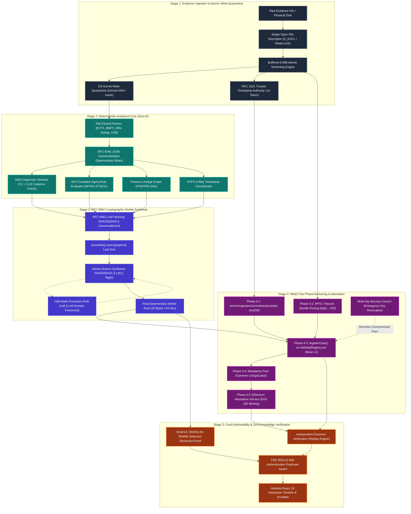

# 🗺️ Aletheia End-to-End System Flow & Cryptographic Architecture

> **Standards Track**: RFC 6962 (Merkle Tree Domain Separation) | RFC 8785 (JSON Canonicalization Scheme - JCS) | RFC 3161 (Trusted Timestamping) | FRE 902(14) & Daubert Legal Admissibility

---

## 1. High-Level Architectural Flow Map



---

## 2. Detailed Technical Sequence: Ingestion to Verification

```mermaid
sequenceDiagram
    autonumber
    actor Attacker as Threat Actor / Adversary
    actor Examiner as Forensic Examiner
    participant OS as Host OS & Kernel Write-Guard
    participant Engine as Deterministic Forensic Core
    participant Merkle as RFC 6962 Merkle Synthesizer
    participant IPFS as IPFS / Filecoin Storage
    participant L2 as Base L2 (AletheiaRegistry.sol)
    actor Peer as Peer Co-Examiner
    participant Court as Court / Cross-Examination

    %% Ingestion
    Note over Examiner,OS: Stage 1: Atomic Ingestion & Hardware Quarantine
    Examiner->>OS: Ingest raw drive/file with single-FD lock
    OS->>Engine: Stream 8 MiB chunks simultaneously to hasher & disk
    Note over OS: Revoke write permissions (stat.S_IREAD / 0444)
    Engine->>OS: Read-back verification (Assert source_hash == dest_hash)
    Engine->>L2: anchorIngestionCommitment(caseId, raw_manifest_hash)

    %% Anti-Forensics Attempt
    Note over Attacker,Engine: Adversarial Attack Attempt
    Attacker--xEngine: Injects 60ms-paced uniform logs (MAD Dilution Attack)
    Engine->>Engine: Inter-arrival dispersion test flags CV < 0.20 (CRITICAL alert)
    Attacker--xEngine: Manipulates system clock backward (-10 min)
    Engine->>Engine: Sequential jump sentinel flags CLOCK_MANIPULATION_DETECTED

    %% Merkle Synthesis
    Note over Engine,Merkle: Stage 2 & 3: Deterministic Normalization & RFC 6962
    Engine->>Merkle: Normalize all events via RFC 8785 Canonical JSON (JCS)
    Merkle->>Merkle: Compute Leaf Hashes = SHA256(0x00 || JCS(Event))
    Merkle->>Merkle: Lexicographically sort leaf digests
    Merkle->>Merkle: Compute Interior Nodes = SHA256(0x01 || Left || Right)
    Merkle-->>Examiner: Emits 32-byte Merkle Root R

    %% Web3 Anchoring
    Note over Examiner,L2: Stage 4: Decentralized Storage & Mandatory Dual-Signing
    Examiner->>IPFS: Pin encrypted .wasp container archive (Returns CID bafy...)
    Examiner->>L2: registerCase(caseId, MerkleRoot, evidenceSha256, ipfsCid, eventCount)
    Note over L2: Verify sender not revoked; check case does not already exist
    Peer->>L2: coSignCase(caseId) [Mandatory Peer Verification]
    Examiner->>L2: recordZKProof(caseId, proofHash) [Selective Disclosure]

    %% Judicial Review
    Note over Examiner,Court: Stage 5: Court Presentation under FRE 902(14)
    Court->>Engine: Re-run open-source ingestion on quarantined .wasp bundle
    Engine->>Court: Recomputed Merkle Root == On-Chain Merkle Root R
    Court->>L2: Check isDualSigned(caseId) == true & isRevoked(examiner) == false
    Court-->>Court: Evidence self-authenticating under FRE 902(14) (Authentication Passes)
```

---

## 3. Cryptographic Deep-Dive by RFC Specification

### 3.1 RFC 8785 — JSON Canonicalization Scheme (JCS)
Different operating systems and JSON libraries emit varying whitespace, key ordering, and floating point representations. Aletheia enforces RFC 8785 to guarantee identical byte output across Windows, Linux, and macOS:

```
[Raw Memory Event Object]
       │
       ▼
1. Keys sorted lexicographically by UTF-16 code units: ("action", "actor", "timestamp_utc")
2. Whitespace eliminated: delimiters strictly (',', ':')
3. Float serialization normalized: no trailing zeroes (e.g. 1.0 -> 1.0)
4. UTF-8 character encoding strictly enforced without escaping forward slashes
       │
       ▼
Canonical Output Bytes: b'{"action":"PROCESS_EXECUTE","actor":"SYSTEM","timestamp_utc":"2026-10-23T22:00:00Z"}'
```

### 3.2 RFC 6962 — Domain-Separated Merkle Tree Computation
To eliminate **second-preimage collision attacks** (where intermediate branch nodes could be substituted as leaf events), Aletheia prepends single-byte domain indicators:

```
                          ┌───────────────────────┐
                          │   Merkle Root (R)     │
                          └───────────┬───────────┘
                                      │
                 ┌────────────────────┴────────────────────┐
                 │ SHA256(0x01 || Node_A || Node_B)        │
                 ├────────────────────┬────────────────────┤
                 │                    │                    │
                 ▼                    ▼                    ▼
      ┌────────────────────┐┌────────────────────┐┌────────────────────┐
      │      Node A        ││      Node B        ││ Odd Node Promotion │
      │SHA256(0x01||L1||L2)││SHA256(0x01||L3||L4)││SHA256(0x01||L5||L5)│
      └─────────┬──────────┘└─────────┬──────────┘└─────────┬──────────┘
           ┌────┴────┐           ┌────┴────┐                │
           ▼         ▼           ▼         ▼                ▼
       ┌───────┐ ┌───────┐   ┌───────┐ ┌───────┐        ┌───────┐
       │Leaf 1 │ │Leaf 2 │   │Leaf 3 │ │Leaf 4 │        │Leaf 5 │
       └───────┘ └───────┘   └───────┘ └───────┘        └───────┘
           ▲         ▲           ▲         ▲                ▲
           │0x00     │0x00       │0x00     │0x00            │0x00
      ┌────┴────┐┌────┴────┐┌────┴────┐┌────┴────┐     ┌────┴────┐
      │Event 1  ││Event 2  ││Event 3  ││Event 4  │     │Event 5  │
      │(RFC8785)││(RFC8785)││(RFC8785)││(RFC8785)│     │(RFC8785)│
      └─────────┘└─────────┘└─────────┘└─────────┘     └─────────┘
```

* **Leaf Domain (`0x00`)**: $\text{LeafHash}_i = \text{SHA256}(0\text{x}00 \,||\, \text{RFC8785}(e_i))$
* **Interior Node Domain (`0x01`)**: $\text{NodeHash} = \text{SHA256}(0\text{x}01 \,||\, \text{Left} \,||\, \text{Right})$
* **Odd Leaf Rule**: When an unbalanced leaf remains at any tier, it is combined with domain preservation: $\text{Parent} = \text{SHA256}(0\text{x}01 \,||\, \text{Left} \,||\, \text{Left})$.

---

## 4. Two-Phase Smart Contract Protocol (`AletheiaRegistry.sol`)

```
             PHASE 1: INGESTION COMMITMENT                     PHASE 2: CASE SEALING
             
      Examiner                  Blockchain              Examiner              Blockchain
         │                           │                     │                       │
         │  anchorIngestionCommitment│                     │  registerCase()       │
         ├──────────────────────────►│                     ├──────────────────────►│
         │  (caseId, rawManifestHash)│                     │  (caseId, MerkleRoot, │
         │                           │                     │   evidenceSha, ipfsCid│
         │                           │                     │   eventCount)         │
         │                           │                     │                       │
         │                           │                     │  coSignCase() [Peer]  │
         │                           │                     ├──────────────────────►│
         │                           │                     │  (caseId)             │
         │                           │                     │                       │
```

1. **Phase 1 (Pre-Analysis)**: Before any timeline parsing occurs, the examiner anchors the raw source manifest hash via `anchorIngestionCommitment(caseId, rawManifestHash)`. This binds the investigator to the exact input data, precluding off-chain selective filtering.
2. **Phase 2 (Post-Analysis)**: Upon timeline reconstruction and RFC 6962 synthesis, the case is sealed via `registerCase(...)`. Attempting to register an already-recorded case reverts (`CaseAlreadyExists`).
3. **Mandatory Peer Co-Signer**: An independent qualified examiner must execute `coSignCase(caseId)` from a distinct non-revoked address to fulfill court dual-signing requirements.

---

## 5. Summary of Guarantees

| Guarantee | Standard / Protocol | Enforcement Mechanism |
|---|---|---|
| **Zero-TOCTOU Ingestion** | Single-FD Read Lock | Simultaneous streaming copy and multi-hash calculation directly from active file descriptor. |
| **Tamper-Evident Timeline** | RFC 6962 Domain Separation | $0\text{x}00$ leaf and $0\text{x}01$ internal branch prefixes prevent second-preimage node substitution. |
| **Cross-Platform Hash Parity** | RFC 8785 (JCS) | Lexicographically sorted dictionary keys and normalized separators produce byte-identical JSON on all OSes. |
| **Emergency Trust Revocation** | Base L2 Smart Contract | 3-of-5 Multi-Sig Security Council can revoke compromised investigator keys instantly. |
| **Insider Tampering Defense** | Mandatory Dual-Sign-Off | Case sealing requires independent peer co-signing verification before court presentation. |
| **Selective Disclosure Privacy** | Groth16 / BN254 ZK-SNARK | Proves an incident event exists in the on-chain Merkle root without disclosing company PII or source code. |
