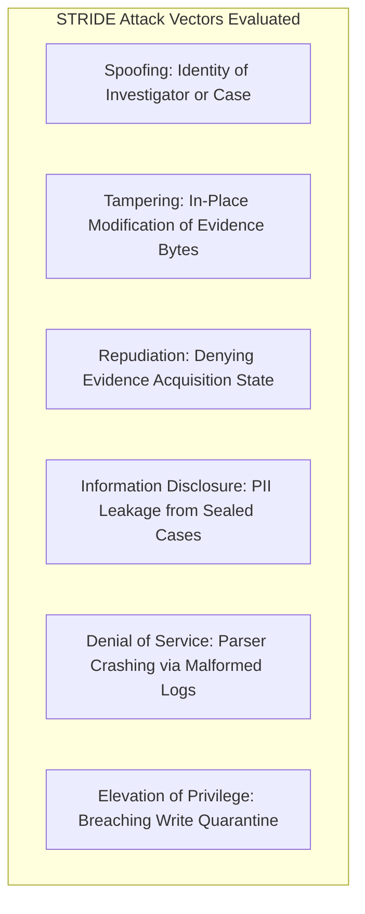

# Aletheia Formal Threat Model (STRIDE Framework)

## 1. System Overview & Trust Assumptions
Aletheia is a Decentralized Digital Forensics and Incident Response (DeDFIR) system. Its mission is to transform raw endpoint forensic artifacts into legally admissible, cryptographically tamper-evident evidence packages suitable for court presentation under the **Daubert Standard** and **FRE 902(14)**.

### Trust Boundaries
1. **Host Boundary**: The endpoint machine where digital evidence originates (untrusted; potentially compromised by rootkit/Trojan).
2. **Forensic Workstation Boundary**: The examiner workstation where Aletheia executes ingestion and analysis (semi-trusted; protected by write-quarantine).
3. **Decentralized Trust Anchor**: The EVM blockchain (Base Sepolia / Base Mainnet / Ethereum) and IPFS (immutable; consensus-enforced).

---

## 2. STRIDE Threat Assessment

### 1. Spoofing (Investigator or Attestation Identity)
* **Threat**: A rogue operator impersonates a licensed forensic investigator to register fraudulent roots on-chain.
* **Mitigation**:
  - The `AletheiaRegistry.sol` contract records `msg.sender` as `leadInvestigator`.
  - Future transfers of case custody require cryptographic signatures recorded on-chain via `transferCustody()`.
  - Ethereum Attestation Service (EAS) attestations are signed using examiner EIP-712 structured data keys.

### 2. Tampering (Evidence Mutation or Backdating)
* **Threat**: An insider or malware modifies log events in `timeline.jsonl` or alters binary evidence on disk.
* **Mitigation**:
  - **OS-Level Write-Quarantine**: Read-only permission locking (`0o444` on POSIX, `icacls /deny Everyone:(W,D)` on Windows) enforced immediately upon file ingestion.
  - **Streaming Dual-Hash**: SHA-256 and Blake3 sidecars are calculated simultaneously.
  - **RFC 6962 Merkle Tree**: Any change to any leaf invalidates the Merkle root $\mathcal{R}$.
  - **Blockchain Immutability**: The root hash $\mathcal{R}$ is permanently anchored in the smart contract. Any verification attempt (`case.verify()`) re-computes all hashes and flags `tamper_detected = True` upon a single-bit mismatch.

### 3. Repudiation (Disputing Incident Timeline)
* **Threat**: An adversary claims that forensic evidence was fabricated after the fact or that timestamps were falsified.
* **Mitigation**:
  - **RFC 3161 Trusted Timestamping**: Queries an external, cryptographically signed Time Stamp Authority (TSA), generating an immutable `.tsr` token.
  - **On-Chain Block Timestamps**: Block confirmation numbers and Ethereum block timestamps irrevocably pin evidence creation to the historical block lattice.

### 4. Information Disclosure (PII or Trade Secret Leakage)
* **Threat**: Public block explorers expose sensitive company IP, employee names, or internal IP addresses.
* **Mitigation**:
  - **Zero Content On-Chain**: Only cryptographic digests (Merkle roots, SHA-256 hashes, and IPFS CIDs) are stored on-chain.
  - **Zero-Knowledge (ZK) Selective Disclosure**: Employs Groth16 / BN254 ZK-SNARK proofs to prove that an incident leaf is included in the Merkle root without disclosing employee usernames, file contents, or proprietary code.
  - **AES-GCM-256 Redaction Engine**: Local reports support reversible key redaction for PII scrubbing prior to external legal disclosure.

### 5. Denial of Service (Parser Bomb / Memory Exhaustion)
* **Threat**: Malicious actor crafts a corrupted `.evtx` or syslog file containing recursive loops or huge chunk headers to crash the forensic analyzer (Zip-bomb / Parser DoS).
* **Mitigation**:
  - Streaming chunked processing: Ingestion limits memory allocation per file chunk.
  - Bounded string scanning: YARA and Sigma engines apply strict length caps to regex tokenization.
  - Isolated subprocess extraction: Parser crashes fail cleanly with recorded error logs without corrupting adjacent evidence.

### 6. Elevation of Privilege (Write-Guard Bypass)
* **Threat**: Attacker gains administrative privileges and revokes read-only status on evidence folders.
* **Mitigation**:
  - Zero-Trust Re-verification: Every execution of `Case.open()` re-scans the append-only `custody/ledger.jsonl` hash chain. If an evidence file has been modified, the hash-chain validation fails immediately, halting the pipeline before tainted data can be analyzed.

---

## 3. Residual Risk & Explicit Non-Goals

Digital forensics and cryptographic attestations can only guarantee integrity within clear boundaries. In accordance with honest engineering and forensic transparency, Aletheia explicitly defines what the tool does **not** defend against:

| Residual Risk / Boundary | Impact | Status & Operational Mitigation |
|---|---|---|
| **Live Acquisition on Compromised Host (Ring-0 Rootkits)** | Critical | If an attacker controls kernel mode (`Ring-0`) prior to or during live triage, kernel syscalls and memory queries can be intercepted or spoofed. Live acquisition cannot guarantee integrity against active rootkits; dead-box disk imaging or hardware write-blockers are mandatory for high-threat scenarios. |
| **Direct Memory Access (DMA) Attacks** | High | Hardware-level DMA bus mastering (e.g. PCIe, Thunderbolt) without active IOMMU or physical hardware write-blocking bridge bypasses OS write-quarantine. Hardware write-blockers required. |
| **Examiner Private Key Theft / Insider Admin** | High | In prototype/testnet, `securityCouncil` is initialized to the deployer EOA. In production, administrative authority must be transferred to a 3-of-5 Gnosis Safe multi-sig wallet, and examiner keys must reside in KMS/HSM hardware tokens. |
| **Base Sepolia Testnet Longevity** | Medium | Testnet contracts carry zero economic finality or legal longevity guarantees. Anchoring on Base Sepolia is for research/demo benchmarking; court-admissible production deployments require Ethereum Mainnet or Base Mainnet. |
| **EVM Chain Reorganization** | Medium | Wait for 64-block finality (Base L2 epoch) before considering attestation irreversible. |
| **IPFS Node Unavailability** | Low | Implement multi-provider decentralized pinning (Filecoin, Arweave, and local IPFS clusters). |
